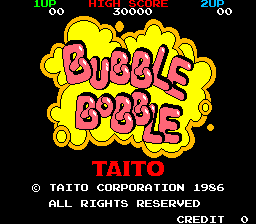

# Bubble Bobble — Arcade Decompilation



A disassembly and decompilation of Taito's 1986 arcade game **Bubble Bobble**
(MAME set `bublbobl`, Japan Ver 0.1).

## Goals

1. **Disassemble** — documented assembler source for all four CPUs (main Z80, sub Z80,
   sound Z80 and the 6801 MCU), plus extracted data (graphics, palettes, text, levels,
   enemy tables, music) in open formats.
2. **Reassemble** — rebuild a byte-exact ROM set from that source that runs in MAME.
3. **Reimplement** — a C# version of the game in
   [The Sharp Kind](https://github.com/aphawkins/the-sharp-kind).

See [PLAN.md](PLAN.md) for the overall plan and
[EXTRACTION_PLAN.md](EXTRACTION_PLAN.md) for the disassembly and reassembly detail.

## ROMs

No ROMs are included in this repository. You must supply your own legally obtained copy
of the `bublbobl` set and place it in `roms/` (`roms/bublbobl/` or `roms/bublbobl.zip`).
The `roms/` folder is git-ignored.

## Requirements

- Python 3 (with Pillow)
- [MAME](https://www.mamedev.org/) (including `unidasm`)
- [GNU Binutils](https://sourceware.org/binutils/) built for `z80-elf` and `m68hc11-elf`
  (see [EXTRACTION_PLAN.md](EXTRACTION_PLAN.md) §12.1)

## Building

```
python tools/build.py
mame bublbobl -rompath build/roms
```

`build.py` checks your ROMs, assembles `src/`, and stops unless every program ROM
matches the original byte for byte. The rebuilt set is written to `build/roms/bublbobl/`.

Other tools:

- `tools/romset.py` — verify the set, write per-CPU images to `build/images/`
- `tools/classify.py` — refresh the byte classification maps in `notes/classmap/`
- `tools/gfx.py` — decode the graphics ROMs into tile sheets, `build/gfx/tiles_bank00..11.png`
  (`--scale 2` to magnify)
- `tools/palette.py` — extract every palette from ROM, `build/gfx/palettes.json` and
  `palettes.png`
- `tools/objects.py` — render a main-CPU RAM image (`C000–FFFF`) to PNG as the hardware
  draws it; `--check <snap folder>` compares the renders with MAME's screenshots
- `tools/sprites.py` — sprite sheets from the sprite draws that `trace.py` logs
  (`sprites.csv`), one sheet per calling routine and one per character, in
  `build/gfx/sprites/` with `sprites.json` and `characters/characters.json`
- `tools/levels.py` — decode the 100 round layouts, `build/levels/round_NNN.json` and `.png`
  plus `rounds.png`, the same in the super mode's palettes (`_super.png`), and the item
  tables (`items.json`); `--check <snap folder>` compares them with RAM snapshots
- `tools/text.py` — catalogue the strings in the main CPU images, `build/text/strings.csv`
- `tools/symbols.py` — export `notes/symbols.toml` as assembler includes, `build/include/`
  (`build.py` runs it)
- `tools/dasmz80.py` — trace Z80 code from the vectors, the traced ranges and the named
  routines, and write a first-pass source to `disasm/<cpu>.s` (`sub`, `sound`, `main_fixed`;
  `--table ADDR:COUNT` for jump tables). It made the first `src/sub/sub.s`
- `tools/dasm6801.py` — trace the MCU code from its vectors and write a first-pass source to
  `disasm/mcu.s` (it made the first `src/mcu/mcu.s`, which is now edited by hand)
- `tools/trace.py` — run MAME headless on a scripted scenario (`--list`) with the debugger
  tracing every CPU, and record executed code, RAM and I/O accesses and sound commands in
  `build/traces/<scenario>/`. `play` records your own play first, then traces the replay;
  `super1p` enters the super mode code on the title.
  `--snap N` adds a screenshot and RAM image every N seconds. Cheats, in a recording and
  its replay (`tools/cheats.lua`): `--round N` starts every game on round N, and
  `--boss-hits 80` traps the round 100 boss in a bubble at once. Needs `MAME_DIR` in
  `config.local.toml`. `rammap.py` reads every run in `build/traces/`, so move runs made
  only for snapshots elsewhere (for example `build/snaps/`)
- `tools/coverage.py` — merge the traced code into the classification maps
- `tools/rammap.py` — write `notes/ram_map.md`: who writes and reads each RAM and I/O address
- `tools/soundcmds.py` — write `notes/sound_commands.md`: every command sent to the sound CPU

`config.local.toml` (git-ignored) holds local paths:

```toml
ROM_DIR = "roms/bublbobl"            # optional
MAME_DIR = "C:/Games/Retro/mame"     # folder with mame.exe
```

## Legal

Bubble Bobble is © Taito Corporation. This project is an unofficial, non-commercial
study and is not affiliated with or endorsed by Taito.
